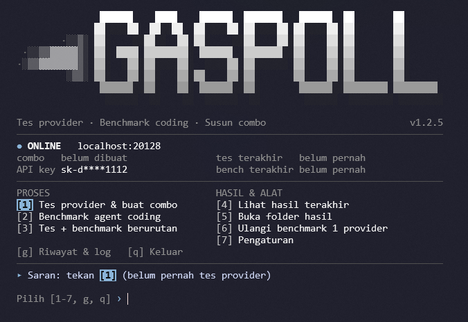
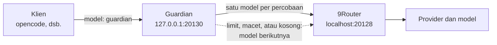

<div align="center">

# GASPOLL



**Uji, bandingkan, dan rangkai combo model terbaik untuk 9Router, langsung dari terminal.**

[](https://github.com/Hyansz/gaspoll/actions/workflows/ci.yml)
[](https://github.com/Hyansz/gaspoll/releases)


[Fitur](#fitur) · [Instalasi](#instalasi) · [Menjalankan](#menjalankan) · [Realtime bot guardian](#realtime-bot-guardian) · [Pemecahan masalah](#pemecahan-masalah) · [Riwayat perubahan](CHANGELOG.md)

</div>

---

## Tentang

GASPOLL adalah alat berbasis terminal (Node.js) untuk [9Router](https://github.com/decolua/9router). Ia menguji semua model dari semua provider, mengukur kecepatan dan keandalannya, menjalankan benchmark kemampuan coding, lalu merangkai model yang lolos menjadi combo. Setiap hasil tersimpan sebagai riwayat yang bisa dibuka kembali.

Untuk pemakaian sehari-hari, menu **Realtime bot guardian** menjaga klien seperti opencode tetap berjalan: saat sebuah model kena limit, macet, atau menjawab kosong, permintaan yang sama langsung dialihkan ke model berikutnya di combo.

## Fitur

| Fitur | Keterangan |
| ----- | ---------- |
| Tes provider dan model | Mengukur waktu respons dan status tiap model, plus ringkasan kegagalan per provider. |
| Combo otomatis | Model yang lolos langsung dirangkai menjadi combo di 9Router. |
| Benchmark agent coding | Skor per tugas untuk membandingkan model secara adil. |
| Ulangi benchmark per provider | Tidak perlu menjalankan ulang semuanya. |
| Riwayat dan log | Lihat hasil lama, buka detail, dan salin log. |
| Realtime bot guardian | Perantara lokal dengan layar live dan failover otomatis antar model. |
| Tampilan adaptif | Unicode di terminal modern, ASCII otomatis di CMD, layout menyesuaikan lebar terminal. |
| Lintas platform | Windows, Linux, dan macOS. Diuji otomatis lewat CI di ketiganya. |
| Tanpa dependensi | Cukup Node.js. Tidak ada `npm install`. |

## Prasyarat

| Kebutuhan | Keterangan |
| --------- | ---------- |
| Node.js | Versi 18 atau lebih baru. CI menguji Node.js 18, 20, dan 22. |
| 9Router | Harus sudah berjalan (alamat bawaan `http://localhost:20128`). |
| Akses 9Router | API key aktif atau password dashboard 9Router. |
| Git | Opsional, hanya untuk instalasi lewat `git clone`. |

> GASPOLL dikembangkan di Windows. `gaspoll.bat` khusus Windows, `gaspoll.sh` untuk Linux dan macOS, dan `node src/cli.js` bisa dijalankan dari terminal mana pun yang punya Node.js.

## Instalasi

### Opsi 1: Git

```bash
git clone https://github.com/Hyansz/gaspoll.git
cd gaspoll
```

### Opsi 2: Unduh ZIP

1. Buka halaman [Releases](https://github.com/Hyansz/gaspoll/releases) dan unduh ZIP rilis terbaru, atau klik **Code**, lalu **Download ZIP** di [halaman repo](https://github.com/Hyansz/gaspoll).
2. Ekstrak ke folder pilihanmu dan buka terminal di folder tersebut.

Tidak ada langkah `npm install`. Proyek ini tidak punya dependensi eksternal.

### Konfigurasi

Salin berkas contoh menjadi `config.json`:

```bash
# Windows (CMD)
copy config.example.json config.json

# Linux, macOS, atau PowerShell
cp config.example.json config.json
```

Lalu sesuaikan isinya, atau biarkan `gaspoll.bat` membuatkan konfigurasi bawaan saat pertama dijalankan.

| Kunci | Fungsi | Bawaan |
| ----- | ------ | ------ |
| `baseUrl` | Alamat URL 9Router | `http://localhost:20128` |
| `apiKey` | API key aktif 9Router. Kosongkan agar diambil otomatis, atau isi manual. | kosong |
| `password` | Password dashboard 9Router. Harus sama dengan password yang kamu pakai untuk login di browser. | `123456` |

Catatan penting:

- `config.example.json` hanya contoh. Program tidak pernah membacanya, yang dibaca adalah `config.json` (atau berkas yang ditunjuk `GASPOLL_CONFIG`).
- Variabel lingkungan `NINE_ROUTER_BASE_URL`, `NINE_ROUTER_API_KEY`, dan `NINE_ROUTER_PASSWORD` menimpa isi berkas konfigurasi.
- `config.json` dan folder `results/` sudah masuk `.gitignore`, jadi API key dan hasil ujimu tidak ikut ter-commit.

## Menjalankan

Pastikan 9Router sudah berjalan, lalu pilih sesuai sistem operasimu:

| Sistem | Perintah |
| ------ | -------- |
| Windows (CMD) | `gaspoll.bat` |
| Windows (PowerShell) | `.\gaspoll.bat` (PowerShell tidak menjalankan berkas di folder saat ini tanpa `.\`) |
| Linux dan macOS | `sh gaspoll.sh`, atau `chmod +x gaspoll.sh` lalu `./gaspoll.sh` (ZIP dari Windows tidak membawa izin eksekusi) |
| Semua sistem | `node src/cli.js` atau `npm start` |

Di Linux, salin ke clipboard butuh salah satu dari `wl-copy`, `xclip`, atau `xsel`, dan membuka folder butuh `xdg-open`. Jika tidak ada, hasil tersimpan di `results/salin-log.txt` dan aplikasi tidak crash.

### Menu utama

| Tombol | Fungsi |
| ------ | ------ |
| `1` | Tes provider dan buat combo |
| `2` | Benchmark agent coding |
| `3` | Tes dan benchmark berurutan |
| `4` | Lihat hasil terakhir |
| `5` | Buka folder hasil |
| `6` | Ulangi benchmark 1 provider |
| `7` | Pengaturan |
| `8` | Realtime bot guardian |
| `g` | Riwayat dan log |
| `q` | Keluar |

Tekan `Ctrl+C` kapan saja untuk menghentikan proses yang sedang berjalan.

### Tampilan terminal

CMD bawaan Windows memakai mode ASCII, sedangkan Windows Terminal dan terminal Linux atau macOS dengan UTF-8 memakai tampilan Unicode penuh. Paksa salah satunya bila perlu:

```bash
node src/cli.js --ascii      # ASCII murni, untuk terminal lama
node src/cli.js --unicode    # paksa Unicode
```

| Variabel lingkungan | Fungsi |
| ------------------- | ------ |
| `GASPOLL_UNICODE=1` | Paksa tampilan Unicode |
| `GASPOLL_ASCII=1` | Paksa tampilan ASCII (sama dengan `--ascii`) |
| `GASPOLL_COMPACT=1` | Paksa header ringkas (`0` untuk banner penuh) |
| `GASPOLL_NOCLEAR=1` | Jangan bersihkan layar antar menu |
| `GASPOLL_VERBOSE=1` | Tampilkan keluaran tes selengkapnya, tanpa ringkasan |
| `GASPOLL_RESULTS=<folder>` | Simpan hasil dan riwayat di folder lain |
| `GASPOLL_CONFIG=<berkas>` | Pakai berkas konfigurasi lain |

Terminal pendek (kurang dari 30 baris) otomatis memakai header ringkas.

Contoh: di CMD `set GASPOLL_UNICODE=1` lalu `node src/cli.js`. Di PowerShell `$env:GASPOLL_UNICODE = 1`. Di Linux dan macOS `GASPOLL_ASCII=1 ./gaspoll.sh`.

## Realtime bot guardian

Menu `[8]` menjalankan perantara OpenAI-compatible di depan 9Router. Klien tidak lagi bicara langsung ke 9Router, melainkan ke guardian. Jika sebuah model gagal, guardian mencoba model berikutnya **di permintaan yang sama**, sehingga klien tidak melihat kegagalan.

Masalah yang diselesaikan: kadang model di combo kena limit tetapi fallback 9Router tidak berpindah, dan sesi coding macet. Guardian membaca kegagalan itu (status, teks limit, respons kosong, atau stream yang berhenti) dan mengambil alih urutannya sendiri.



### Cara pakai

1. Buat combo lewat menu `[1]` supaya `results/combo-auto-combo.json` ada.
2. Jalankan guardian dari menu `[8]`, atau langsung:

   ```bash
   node src/guardian.js
   ```

3. Arahkan klien ke guardian:

   | Pengaturan klien | Nilai |
   | ---------------- | ----- |
   | Base URL | `http://127.0.0.1:20130/v1` |
   | Model | `guardian` |
   | API key | API key 9Router yang sama (diteruskan apa adanya ke 9Router) |

4. Pakai seperti biasa. Layar guardian menampilkan model yang sedang melayani, status tiap model, dan log pindah model secara live.

Tombol di layar guardian: `r` tes semua model, `1` reset status, `q` kembali ke menu.

### Perilaku

- **Urutan.** Model dicoba menurut urutan `results/combo-auto-combo.json`. Berkas itu dibaca ulang otomatis saat berubah, jadi combo baru dari menu `[1]` langsung terpakai tanpa restart.
- **Tidak mengubah apa pun.** Combo di 9Router dan `combo-auto-combo.json` tidak pernah diubah. Urutan efektif hanya ada di memori guardian.
- **Cooldown bertahap.** Model yang gagal ditahan 20 detik, lalu 40, 80, dan seterusnya sampai maksimal 300 detik. Setelah 5 kegagalan beruntun, atau bila model tidak ditemukan, model dinonaktifkan dan hanya dicek ulang tiap 2 menit.
- **Pemulihan otomatis.** Model kembali ke posisi aslinya setelah 2 cek berhasil beruntun.
- **Batas wajar.** Satu permintaan mencoba paling banyak 8 model dan paling lama 150 detik. Jika semua gagal, klien menerima error 503 berisi ringkasan percobaan.
- **Stream aman.** Awal stream ditahan sebentar untuk mendeteksi teks limit. Jika stream terputus di tengah jalan, klien menerima event error yang jelas dan model itu ditandai bermasalah.
- **Rahasia aman.** API key tidak pernah muncul di layar, log, maupun berkas status.

Status model: `OK` (sehat), `cooldown` (ditahan sementara), `nonaktif` (gagal berulang atau tidak ditemukan; dipakai paling akhir sebagai upaya terakhir).

### Opsi

| Opsi | Fungsi | Bawaan |
| ---- | ------ | ------ |
| `--port N` | Port guardian (hanya `127.0.0.1`) | `20130` |
| `--model-name NAMA` | Nama model virtual untuk klien | `guardian` |
| `--first-byte DETIK` | Batas tunggu respons pertama | `30` |
| `--timeout DETIK` | Batas satu percobaan non-stream | `90` |
| `--cooldown DETIK` | Cooldown awal model yang gagal | `20` |
| `--watch DETIK` | Cek berkala model yang sehat | mati |
| `--limit-pattern RE` | Tambahan pola teks limit (regex) | kosong |
| `--no-ui` | Tanpa layar live, cetak log biasa | |

Pola teks limit tambahan juga bisa diberikan lewat variabel `GASPOLL_GUARD_PATTERN`.

### Berkas yang ditulis

| Berkas | Isi |
| ------ | --- |
| `results/combo-state.json` | Status tiap model, tersimpan antar sesi |
| `results/guardian-failures.log` | Catatan tiap kegagalan (status dan potongan isi, key disamarkan), diputar otomatis di 1 MB. Berguna untuk menyetel pola limit. |

### Batasan

- Guardian hanya menangani `POST /v1/chat/completions` (gaya OpenAI). Endpoint lain diteruskan apa adanya ke 9Router.
- Klien yang memakai format `/v1/messages` (misalnya Claude Code) belum didukung.
- Pola teks limit bersifat umum. Bila sebuah provider memakai kalimat limit yang tidak dikenali, tambahkan lewat `--limit-pattern`.

## Pemecahan masalah

| Gejala | Penyebab dan solusi |
| ------ | ------------------- |
| Semua model gagal dengan "api key ditolak" (401/403) | API key salah. Ganti lewat menu `7` (Pengaturan). |
| Pesan bahwa router belum jalan | Jalankan 9Router lebih dulu, lalu cek `baseUrl` di `config.json`. |
| `login dashboard gagal (HTTP 429)` | IP diblokir sementara oleh 9Router karena terlalu banyak percobaan login. Tunggu sesuai waktu pada pesan, lalu buat combo tanpa tes ulang: `node src/test-9router.js --apply --name auto-combo`. |
| `login dashboard gagal (HTTP 401)` atau combo ditolak (401) | Password dashboard di menu `7` tidak sama dengan password login dashboard di browser. |
| `login dashboard gagal (HTTP 5xx)` | Error di sisi 9Router, bukan masalah password. Cek log 9Router. |
| Dashboard meminta ganti password (`mustChangePassword`) | Instalasi 9Router baru. Buka dashboard sekali di browser dan tetapkan password, lalu isi di menu `7`. |
| Guardian: `Failed to connect` dari klien | Guardian belum berjalan, atau berjalan di port lain. Cek layar guardian dan `--port`. |
| Guardian: port sudah dipakai | Jalankan dengan port lain: `node src/guardian.js --port 20131`. |
| Guardian menjawab 503 "Belum ada combo" | Jalankan menu `1` dulu supaya `results/combo-auto-combo.json` terbuat. |
| Karakter aneh atau garis putus-putus di CMD | Gunakan Windows Terminal, atau paksa mode ASCII dengan `--ascii`. |

## Pengujian

```bash
npm test
```

Rangkaian tes (lebih dari 140 tes) mencakup alur menu, tata letak di berbagai lebar terminal, mode ASCII dan Unicode, diagnosis login, serta skenario error dari 9Router tiruan, termasuk perilaku failover guardian. Tes memakai folder hasil sementara, jadi data di `results/` tidak tersentuh.

## Struktur proyek

```text
gaspoll/
├── src/
│   ├── cli.js              # menu utama dan alur interaktif
│   ├── ui.js               # tampilan, warna, dan tata letak
│   ├── lib.js              # fungsi bersama dan konfigurasi
│   ├── guardian.js         # Realtime bot guardian (perantara dan layar live)
│   ├── paging.js           # paginasi tampilan riwayat
│   ├── test-9router.js     # tes provider dan model
│   ├── bench-9router.js    # benchmark agent coding
│   ├── show-results.js     # tampilan hasil
│   ├── verify-combos.js    # verifikasi combo
│   └── ui-preview.js       # pratinjau tampilan
├── test/                   # rangkaian tes otomatis
├── docs/                   # gambar untuk dokumentasi
├── .github/workflows/      # CI (Linux, macOS, Windows)
├── config.example.json     # contoh konfigurasi (tidak dibaca program)
├── gaspoll.bat             # peluncur Windows
├── gaspoll.sh              # peluncur Linux dan macOS
├── CHANGELOG.md
└── LICENSE
```

## Keamanan

- Jangan membagikan atau meng-commit `config.json`. Berkas itu berisi API key dan password.
- Guardian hanya mendengarkan di `127.0.0.1`, jadi tidak bisa diakses dari jaringan lain.
- Folder `results/` dapat memuat nama model, alamat router, dan potongan pesan error dari provider, jadi periksa dulu sebelum membagikannya.
- Nilai mirip kunci di folder `test/` adalah data palsu untuk keperluan tes.

## Riwayat perubahan

Lihat [CHANGELOG.md](CHANGELOG.md).

## Lisensi

Dirilis di bawah lisensi MIT. Lihat berkas [LICENSE](LICENSE).
